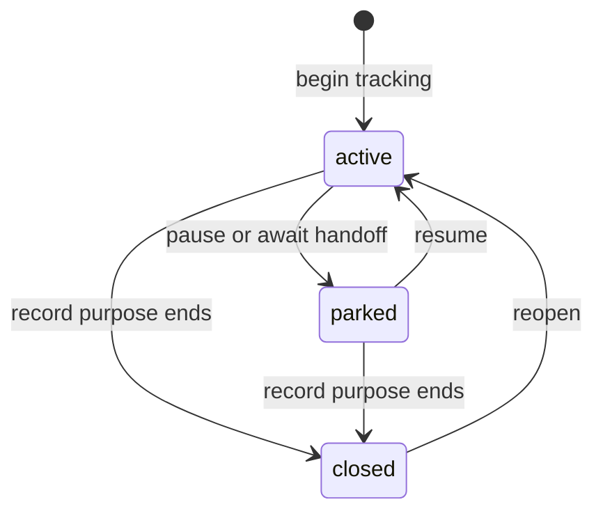
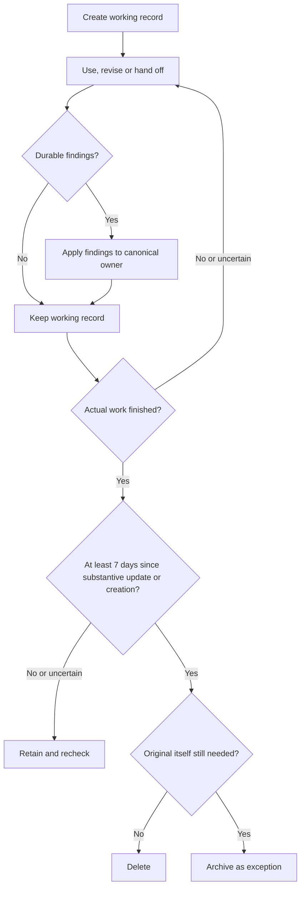

## Working artifact lifecycle

Inbox documents are **temporary evidence for ongoing work**, not canonical documents that advance toward permanent approval. Create, revise, review and hand off records as the work requires. Extract durable findings into their actual canonical owner; that transfer neither completes the work nor turns the Inbox original into canonical documentation.

### Optional status

`status` describes the **current usefulness of a single work record**. It is not a task/PR state, quality grade, review approval or cleanup permission. Omit it unless maintaining this distinction helps continuity; absence means **unspecified**, not `active`.

| Status | Meaning |
| --- | --- |
| `active` | Used or updated for current work |
| `parked` | Temporarily set aside, awaiting a dependency, continuation or handoff |
| `closed` | This record has served its immediate purpose; the work unit may still be active |

Change the field only for a real transition. Reviews can occur in any state; a completed review does not automatically change it. `closed` does not indicate the underlying work is complete, and archived/deleted records are handled by their location or removal, not extra `status` values.

## Completion, protection and disposal

Do not infer completion from a `status`, document review, copying findings into canonical sources, or a PR merge/close. Confirm remaining tasks, blockers, verification and handoffs.

After the **actual work is finished**, keep records until at least **seven days** after their creation or last substantive update. Rename, move, merge and metadata-only status edits do not restart that protection period. If completion, timing or preservation need is uncertain, retain and reassess.

Prefer deletion when needed context can be reconstructed from code, canonical docs, tests, PRs or Git history. Archive only when the original is necessary for an ongoing citation, reproduction or audit and recovering it would be materially costly. Use `.inbox/archive/YYYY-MM-DD/` (archive date), preserving work-unit identity. Do not archive unfinished work as completed; for a bundle, verify cleanup eligibility for every contained record.

No status ledger or automatic cleanup is required. Changes still follow repository authorization and safety rules.
