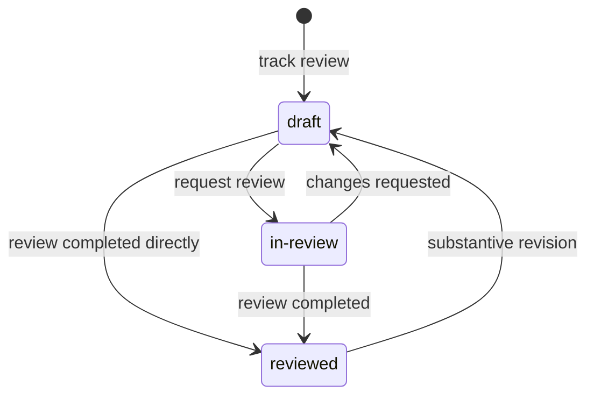
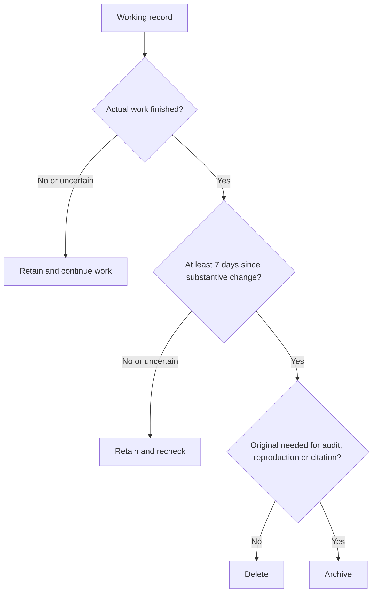

## Optional document status

`status` tracks the **review of an individual working document**, not Issue/PR progress, canonical approval or readiness to delete. Omit it if review state is not being actively maintained. An absent status is **unknown**, not implicitly `draft`.

| Value | Meaning |
| --- | --- |
| `draft` | Content is being prepared or substantially revised |
| `in-review` | A concrete review is under way |
| `reviewed` | A review was completed; the record can still contain open work |

Update `status` only when that transition actually occurs. A `reviewed` document is still non-canonical, and neither that value nor a merged PR means the underlying work is finished.

## Work completion and cleanup

Keep working records while investigation, implementation, verification or handoff remains. Promote durable conclusions to the relevant canonical source without treating promotion alone as work completion.

Delete or archive a record only when **both** its actual work is finished and at least **seven days** have elapsed since its creation or last substantive update. A move, rename, merge or metadata-only status edit does not restart the clock. If completion or timing is uncertain, retain it.

Prefer deletion when the important context can be recovered from canonical documents, code, tests, PRs or Git history. Archive only when the original itself remains necessary and is materially costly to recover; use `.inbox/archive/YYYY-MM-DD/` (archive date) and preserve work-unit identity. Do not classify unfinished work as archived/completed. For bundles, verify the conditions for each retained record before removing the bundle.

No status ledger or automatic cleanup is required. Changes still require normal authorization.
